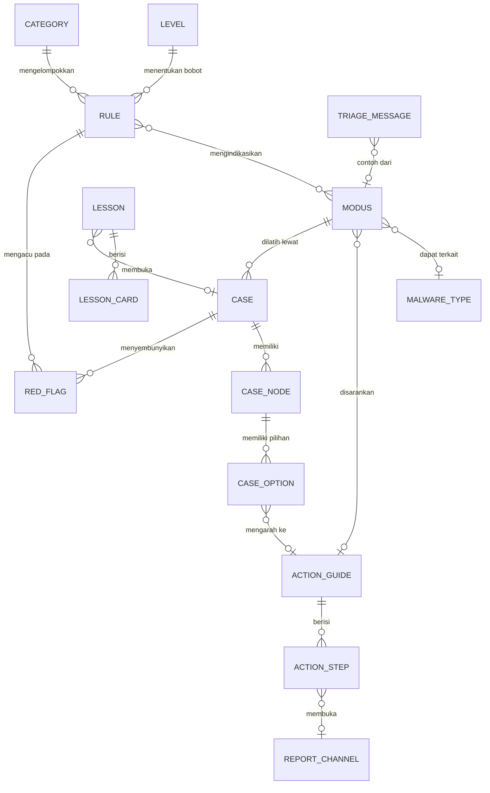

# DATA_MODEL.md: Model Data Konten & Data Lokal

Tidak ada database server. Ada dua jenis data: **konten statis** (JSON dibundel, hanya-baca) dan **data lokal** (`localStorage`, hanya progres).

## 1. Relasi konten (ERD)

Entitas konten (hanya-baca, divalidasi Zod): `LEVEL, RULE, CATEGORY, MODUS, MALWARE_TYPE, CASE, CASE_NODE, CASE_OPTION, RED_FLAG, ACTION_GUIDE, ACTION_STEP, REPORT_CHANNEL, TRIAGE_MESSAGE, LESSON, LESSON_CARD, RISK_BAND`.

## 2. Data lokal (`LocalProgress`)

| Bagian | Isi | Catatan |
|---|---|---|
| `lessonsDone` | id pelajaran selesai | tanpa data pribadi |
| `actionChecks` | `guideId -> [stepId]` | centang checklist Lindungi |
| `caseAttempts` | skor, peringkat, kode, waktu | merujuk konten lewat ID |
| `triageBest` | rekor Kilat 2 Menit | |
| `safeword` | kata + waktu | **opsional, default mati**, bisa dihapus |

Aturan: kunci diawali `jagaruang:`; ada `schemaVersion`; `clearAll()` menghapus semuanya; semua akses di dalam try/catch.

## 3. Aturan integritas
- ID harus saling cocok (modus <-> malware <-> action guide <-> case).
- Item rusak dilewati + `console.warn`. Satu item rusak tidak boleh menjatuhkan aplikasi.
- Semua nama merek, nomor, dan domain pada konten adalah **rekaan** (`example.com`, `.test`, `.invalid`).
